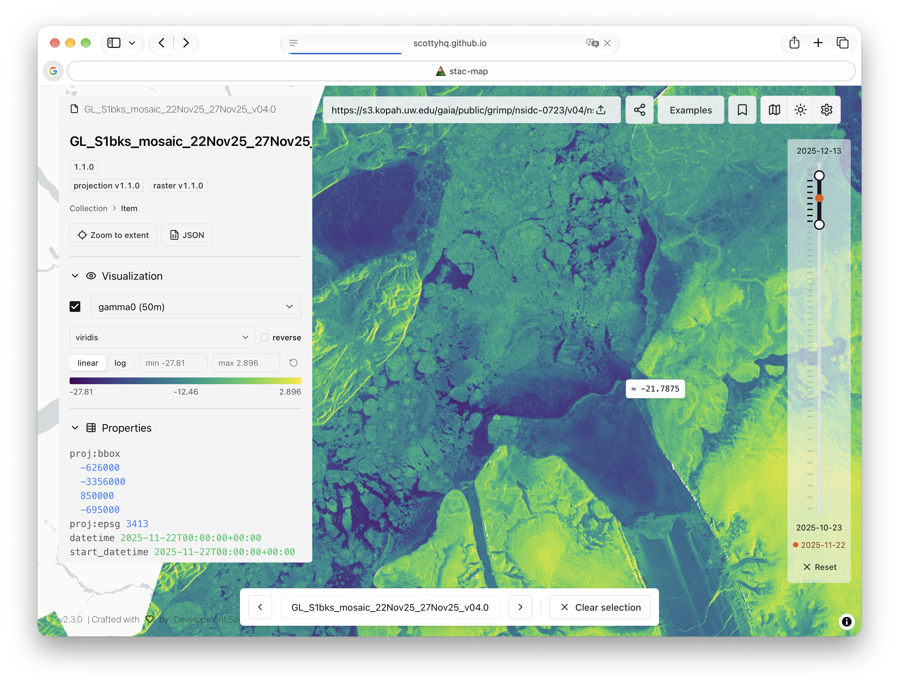

# stac-map

> [!IMPORTANT]
> **This is a personal demo fork.** Development happens upstream at
> [developmentseed/stac-map](https://github.com/developmentseed/stac-map), and
> that is where issues, discussion, and pull requests belong. This fork is not
> maintained as a separate project and may be rebased, rewritten, or deleted at
> any time.

The fork is deployed at <https://scottyhq.github.io/stac-map/> to demo a few
experimental features, here showing a GRIMP Sentinel-1 mosaic of Greenland
read from a stac-geoparquet index:



Features added compared to upstream:

- **Pixel values on hover** for single-band COGs. Values are marked
  approximate (≈) while a lower-resolution overview is showing.
- **Colormaps for single-band COGs**: a colormap picker with a reverse toggle,
  linear or log scaling, editable min/max, and a legend.
- **Stepping through stac-geoparquet items in time**: previous/next buttons
  (and ←/→ keys) move to the next or previous item covering the same place.
  The map view stays put while you step.
- **The datetime slider stays visible while an item is selected**, with the
  selected item's date and a tick for every item at that place marked on it.
- **Collection title and description from stac-geoparquet metadata**, read
  from the STAC Collection that writers such as rustac embed in the file.
- deck.gl-raster upgraded to 0.10.

Some of these may be proposed upstream. Everything below is the upstream
README.

---

[](https://github.com/developmentseed/stac-map/actions/workflows/ci.yaml)
[](https://github.com/developmentseed/stac-map/deployments/github-pages)
[](https://github.com/developmentseed/stac-map/releases)

The map-first, single-page, statically-hosted STAC visualizer at <https://developmentseed.org/stac-map>.

Includes:

- Client-side COG rendering via [deck.gl-raster](https://github.com/developmentseed/deck.gl-raster)
- Web map service display
- [stac-geoparquet](https://github.com/radiantearth/stac-geoparquet-spec) visualization, upload, and export
- React component for re-use in other applications

<!-- markdownlint-disable MD033 -->
<picture>
  <source media="(prefers-color-scheme: dark)" srcset="img/stac-map-dark.png">
  
</picture>
<!-- markdownlint-enable MD033 -->

## Deploying

See [DEPLOY.md](./DEPLOY.md).

## Development

Get [yarn](https://yarnpkg.com/), then:

```shell
git clone git@github.com:developmentseed/stac-map
cd stac-map
yarn install
yarn dev
```

This will open a development server at <http://localhost:5173/stac-map/>.

We have some code quality checks:

```shell
yarn lint
yarn format
```

And some simple tests:

```shell
yarn playwright install
yarn test
```

## Contributing

We have some [architecture documentation](./docs/architecture.md) to help you get the lay of the land.
We use Github [Pull Requests](https://github.com/developmentseed/stac-map/pulls) to propose changes, and [Issues](https://github.com/developmentseed/stac-map/issues) to report bugs and request features.

We use [release-please](https://github.com/googleapis/release-please) to create [releases](https://github.com/developmentseed/stac-map/releases).
This requires our commit messages to conform to [Conventional Commits](https://www.conventionalcommits.org/en/v1.0.0/).
